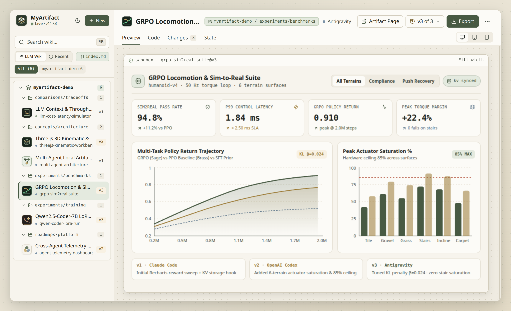
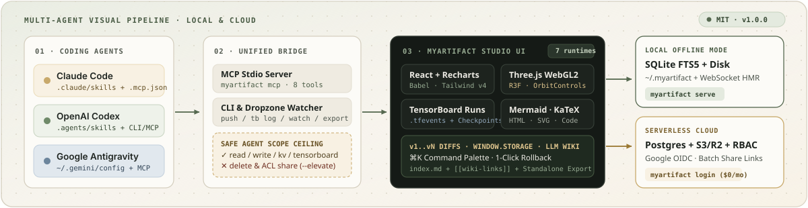
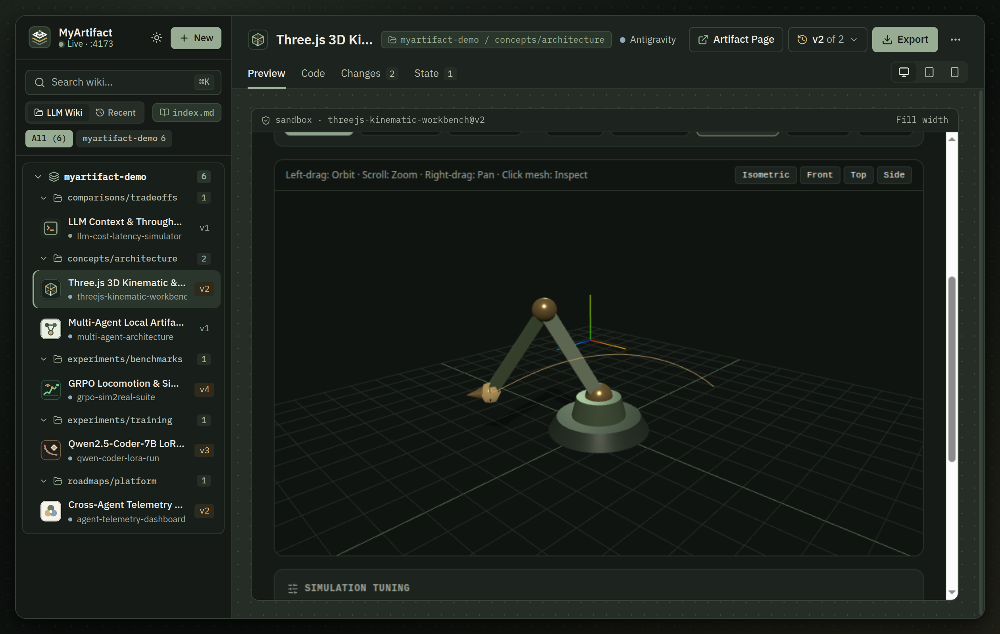
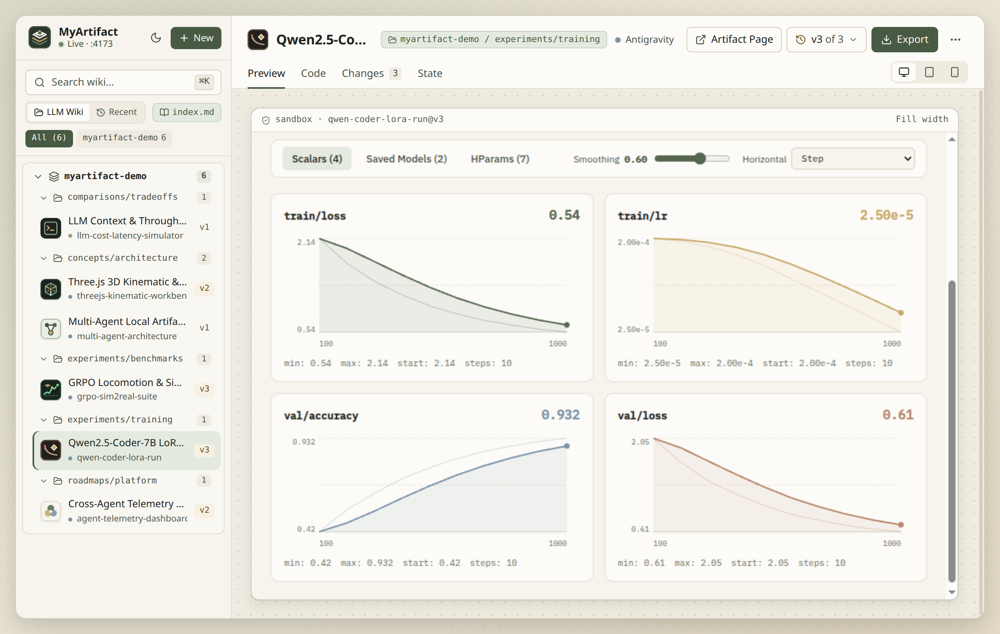
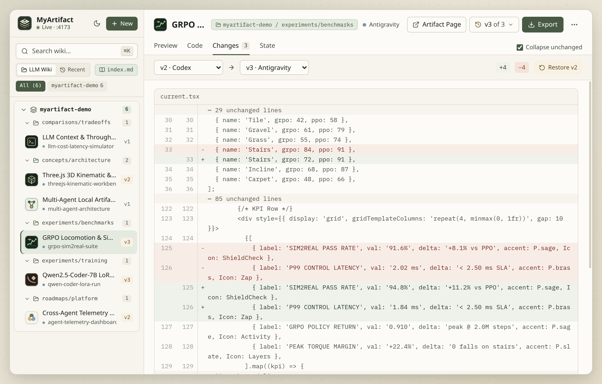
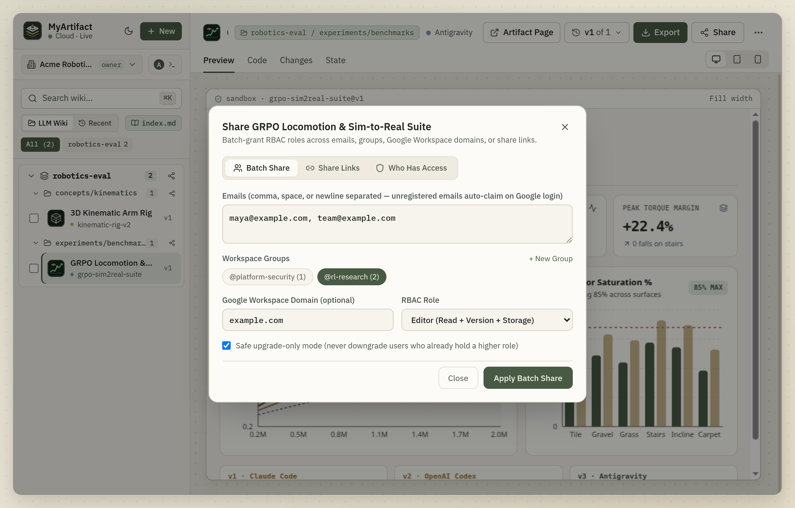
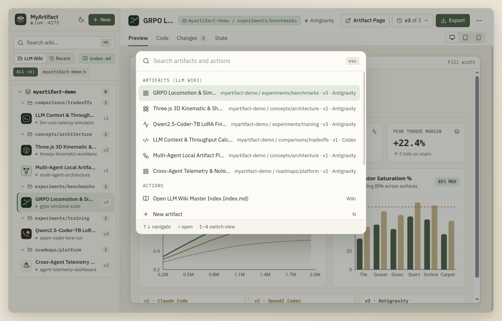

<div align="center">

# MyArtifact

**Local-First & Cloud Visual Artifact Studio + MCP Server (`v1.0.0`)**  
*For **Claude Code**, **OpenAI Codex**, and **Google Antigravity***

[](https://www.npmjs.com/package/myartifact)
[](./LICENSE)
[](https://nodejs.org/)
[](https://modelcontextprotocol.io/)
[](./docker-compose.yml)

<br />

<picture>
  <source media="(prefers-color-scheme: dark)" srcset="./docs/images/hero-studio-night.png" />
  <source media="(prefers-color-scheme: light)" srcset="./docs/images/hero-studio-day.png" />
  
</picture>

</div>

**MyArtifact** gives **Claude Code**, **OpenAI Codex**, and **Google Antigravity** a shared, versioned visual studio for interactive React dashboards, Three.js 3D scenes, HTML mini-apps, Mermaid diagrams, SVG graphics, Markdown (KaTeX), and TensorBoard runs—running **100% locally** or in **stateless cloud mode**.

<p align="center">
  
</p>

---

## Quickstart

> **Prerequisite:** Node.js **>= 22.5.0** (uses built-in `node:sqlite`, zero native compilation) or **Docker**.

### Option A — Connect to Cloud (Zero Server Setup)

```bash
npm i -g myartifact
myartifact login --cloud https://example.com   # Add --device for SSH / headless
myartifact setup                               # Installs SKILL.md + .mcp.json
```

### Option B — Local Offline Studio (`http://127.0.0.1:4173`)

```bash
npm i -g myartifact
myartifact setup
myartifact serve
```

Or run via Docker Compose:

```bash
docker compose up -d --build
```

---

## Visual Tour & Highlights

- **Sandboxed Multi-Runtime Renderer:** In-browser Babel/TSX + Tailwind CSS with pre-mapped `react`, `recharts`, `lucide-react`, `three` (`OrbitControls`, `GLTFLoader`), `@react-three/fiber`, `d3`, `mermaid`, and `katex`.
- **Immutable History, Diffs & Rollback:** Every push creates `v1`, `v2`, `v3`... tagged by assistant with side-by-side diffs and 1-click **Restore `vN`**.
- **Persistent `window.storage`:** Async key-value store (up to 20 MB per artifact) synced to SQLite/Postgres and editable live in the **State** tab, plus single-file offline HTML export.
- **Unified Agent Bridge:** Shared MCP stdio server (`myartifact mcp`), CLI (`myartifact push` / `get` / `list`), Dropzone watcher (`~/.myartifact/dropzone/`), and LLM Wiki (`index.md` / `log.md`).
- **Cloud Ready:** Optional Google OIDC login, cascading RBAC folders, Batch Sharing, S3/R2 presigned transfers (`> 4.5 MB`), and conditional `ETag` sync.

| Interactive Three.js WebGL2 Workbenches | Native TensorBoard Runs & Checkpoints |
| :---: | :---: |
|  |  |
| **Cross-Agent Diffs & 1-Click Rollback** | **Cloud Cascading RBAC & Batch Sharing** |
|  |  |

---

## Studio Keyboard Shortcuts

| Shortcut | Action |
| :--- | :--- |
| `⌘K` / `Ctrl+K` | Open / close the **Command Palette** (`↑`/`↓` navigate, `↵` open) |
| `⌘S` / `Ctrl+S` | **Save Iteration** (`vN+1` checkpoint while editing in **Code**) |
| `1` / `2` / `3` / `4` | Switch tabs: **Preview** (`1`), **Code** (`2`), **Changes** (`3`), **State** (`4`) |
| `N` | Open **New Artifact** modal |
| `J` / `K` | Step **backward** (`vN-1`) / **forward** (`vN+1`) through versions |
| `Esc` | Exit **Zen** fullscreen mode or close open modals/overlays |

<p align="center">
  
</p>

---

## For Coding Agents (MCP & CLI)

Paste this bootstrap prompt into **Claude Code**, **Codex**, or **Antigravity**:

```text
Read https://example.com/llms.txt to connect and publish to MyArtifact Cloud.
Check CLI & auth with `myartifact whoami` (if missing, run `npm i -g myartifact`; if logged out, ask the user to run `myartifact login --cloud https://example.com && myartifact setup`).
Call `artifact_wiki_index()` first, prefer interactive react/html/threejs/mermaid/tensorboard artifacts over plain markdown, iterate with `artifact_update` + `[[wiki-links]]`, and return the live artifact URL.
```

### MCP Tools (`myartifact mcp`)

| Tool | Purpose |
| :--- | :--- |
| `artifact_wiki_index` | Read project/category catalog (`index.md`) and audit timeline (`log.md`) |
| `artifact_create` / `artifact_update` | Create or version (`vN+1`) visual artifacts (`react`, `html`, `mermaid`, `svg`, `markdown`) |
| `artifact_get` / `artifact_list` | Inspect source/versions or run FTS5 search by project, category, or agent |
| `artifact_storage_set` | Seed or update `window.storage` key-value state |
| `tb_log_scalars` / `tb_save_checkpoint` | Log TensorBoard training scalars and version model checkpoints |

### Essential CLI Commands

```bash
myartifact login --cloud https://example.com   # OAuth PKCE (--device for SSH, --elevate for deletes/ACL)
myartifact setup                               # Write .agents/skills, .claude/skills, and .mcp.json (--global for user home)
myartifact serve --port 4173                   # Start local Studio UI, WebSocket reload & dropzone watcher
myartifact push ./chart.tsx --id my-chart --project demo --category benchmarks
myartifact index --project demo                # Print LLM Wiki index.md catalog
myartifact list --query "latency"              # Full-text search across artifacts
myartifact get my-chart --version 1            # Print source code (--json for metadata + storage)
```

---

## Documentation & Development

- **Cloud Deployment Methodology:** [docs/cloud-deployment.md](./docs/cloud-deployment.md) (Vercel + Neon Postgres + R2/S3 + Cloudflare DNS)
- **Release & Agent Rules:** [AGENTS.md](./AGENTS.md) (`feat/*` $\rightarrow$ `dev` $\rightarrow$ `main` pipeline & pre-push checks)

```bash
npm audit --omit=dev --audit-level=moderate
npx tsc --noEmit
npm run build
npm test
```

## License

Released under the [MIT License](./LICENSE). Copyright © 2026 [TannedCung](https://github.com/TannedCung).
