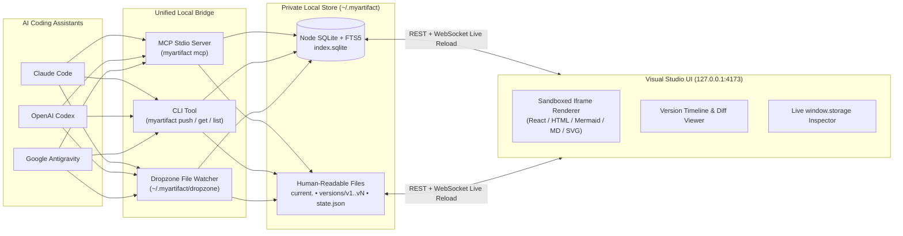

<div align="center">

# MyArtifact

**Local-First, Private, Cross-Assistant Visual Artifact Studio & MCP Server**  
*For **Claude Code**, **OpenAI Codex**, and **Google Antigravity***

[](./LICENSE)
[](https://nodejs.org/)
[](https://www.typescriptlang.org/)
[](https://modelcontextprotocol.io/)
[](./docker-compose.yml)

</div>

---

**MyArtifact** brings the full **Claude Web Artifacts** experience—live sandboxed React/HTML/Mermaid/Markdown/SVG rendering, immutable version timelines (`v1`, `v2`, `v3`...), side-by-side code diffs, and persistent `window.storage` mini-app state—directly to your local machine.

Unlike cloud-locked artifact viewers, **MyArtifact** runs 100% locally and acts as a **unified visual workspace shared across all your terminal and IDE coding assistants** (**Claude Code**, **Codex**, and **Antigravity**). One assistant can generate a `v1` interactive dashboard or architecture diagram, and another assistant (or you) can inspect, iterate, diff, or roll back to `v2` in real time.

---

## Architecture Overview



---

## Key Features

### 1. Claude-Compatible Sandboxed Renderer
Every artifact renders inside an isolated browser sandbox with zero build-step friction:
- **React (`.tsx` / `.jsx`)**: Live in-browser Babel + TypeScript compilation with **Tailwind CSS** and pre-mapped ESM libraries ready to `import`:
  - `react`, `react-dom/client`
  - `lucide-react` (Icons)
  - `recharts` (Charts & data visualization)
  - `d3`, `three`, `lodash`, `papaparse`, `mathjs`, `canvas-confetti`
- **HTML / CSS / JS (`.html`)**: Single-file web applications with Tailwind CSS and `window.storage` automatically injected.
- **Mermaid Diagrams (`.mmd`)**: Flowcharts, sequence diagrams, architecture graphs, ER & state diagrams.
- **SVG Graphics (`.svg`)**: Responsive vector rendering on a studio grid canvas.
- **Markdown (`.md`)**: GitHub Flavored Markdown with embedded `mermaid` diagram rendering and **KaTeX** math support.
- **Code Snippets**: Clean syntax-formatted fallback for `.ts`, `.py`, `.rs`, `.go`, `.sql`, `.json`, and `.sh`.

### 2. Immutable Version History, Diffs & Rollback
- Every update creates an immutable checkpoint (`v1`, `v2`, `v3`...) tagged with the authoring assistant (`claude-code`, `codex`, `antigravity`, `watcher`, or `user`) and a commit summary.
- Step backward and forward through the version timeline in the header bar.
- Compare any two versions side-by-side in the **Diff** tab with line addition/deletion counts and one-click **Restore `vN`** rollback.

### 3. Persistent Local State (`window.storage`)
Implements the Claude Artifacts-compatible async `window.storage` key-value API so interactive React and HTML mini-apps remember user data across refreshes and sessions:
```tsx
// Read persistent state
const saved = await window.storage.get('workspace_notes');
const notes = saved ? JSON.parse(saved.value) : [];

// Write persistent state (up to 20 MB per artifact)
await window.storage.set('workspace_notes', JSON.stringify(nextNotes));

// Delete a key or list keys by prefix
await window.storage.delete('temp_key');
const { keys } = await window.storage.list('note:');
```
- Backed by both SQLite (`artifact_kv_store`) and a human-readable `state.json` file on disk.
- Inspect, add, edit, or delete keys live from the **State** tab in the Web UI.

### 4. Triple Integration Bridge (MCP + CLI + Dropzone Watcher)
- **MCP Server (`myartifact mcp`)**: Native Model Context Protocol server over `stdio` exposing 5 tools (`artifact_create`, `artifact_update`, `artifact_get`, `artifact_list`, `artifact_storage_set`).
- **CLI (`myartifact push`, `list`, `get`)**: Lightweight shell commands that any agent or script can invoke.
- **Dropzone File Watcher**: Drop or edit any file in `~/.myartifact/dropzone/` (or custom `--watch` directories) to auto-create and version artifacts with instant WebSocket hot-reload.

### 5. Standalone Single-File HTML Export
- Click the **Download** button (or call `GET /api/artifacts/:id/export?download=1`) to bundle any artifact version—including its current `window.storage` snapshot—into a self-contained `.html` file you can share or open offline.

---

## Quick Start

> **Prerequisite**: Node.js **>= 22.5.0** (uses Node's native `node:sqlite` module with zero native C++ compilation required) or **Docker**.

### Option A: Docker Compose (Recommended for Always-On Local Daemon)

```bash
# Build and start the background container (persists data to ~/.myartifact)
docker compose up -d --build

# Open the studio at http://127.0.0.1:4173
# Check container health & logs
docker compose ps
docker compose logs -f
```

### Option B: Direct Node.js Build & Run

```bash
# 1. Install dependencies
npm install

# 2. Build the CLI, MCP server, backend daemon, and React Web UI
npm run build

# 3. Install workspace skills (SKILL.md) and MCP config (.mcp.json)
node dist/cli/cli.js setup

# 4. Start the local visual studio & watcher daemon (http://127.0.0.1:4173)
npm start
```

---

## Assistant Integration Guide

Run `setup` to automatically generate skill instructions and MCP configuration for **Antigravity**, **Claude Code**, and **Codex**:

```bash
# Configure current project workspace (.agents/skills, .claude/skills, .mcp.json)
node dist/cli/cli.js setup

# Also install into global user skill directories (~/.gemini, ~/.claude, ~/.codex)
node dist/cli/cli.js setup --global
```

| Assistant | Generated Skill Path | MCP Configuration |
| :--- | :--- | :--- |
| **Google Antigravity** | `.agents/skills/myartifact/SKILL.md`<br>`~/.gemini/config/skills/myartifact/SKILL.md` | Uses `.mcp.json` or CLI via skill instructions |
| **Claude Code** | `.claude/skills/myartifact/SKILL.md`<br>`~/.claude/skills/myartifact/SKILL.md` | Auto-discovers `.mcp.json` in workspace root |
| **OpenAI Codex** | `.agents/skills/myartifact/SKILL.md`<br>`~/.codex/skills/myartifact/SKILL.md` | Uses CLI or MCP stdio server (`myartifact mcp`) |

### Manual MCP Server Configuration (`.mcp.json`)

```json
{
  "mcpServers": {
    "myartifact": {
      "command": "node",
      "args": ["/absolute/path/to/MyArtifact/dist/cli/cli.js", "mcp"]
    }
  }
}
```

---

## MCP Tools Reference

When mounted as an MCP server, **MyArtifact** provides the following tools to your coding assistant:

| Tool Name | Description | Key Arguments |
| :--- | :--- | :--- |
| `artifact_create` | Create a new artifact (or upsert a new version by `slug`). | `title`*, `content`*, `slug`, `type`, `agent`, `project`, `tags`, `upsert` |
| `artifact_update` | Update an existing artifact by ID or slug and record `vN+1`. | `id`*, `content`*, `title`, `summary`, `agent` |
| `artifact_get` | Fetch artifact source code, version history, and `window.storage`. | `id`*, `version`, `includeStorage` |
| `artifact_list` | Full-text search (FTS5) and filter artifacts across assistants. | `query`, `agent`, `type`, `project`, `limit` |
| `artifact_storage_set` | Seed or update a key-value entry in `window.storage`. | `id`*, `key`*, `value`* |

---

## CLI Reference

```bash
# Start the local web studio, REST/WebSocket server, and dropzone watcher
node dist/cli/cli.js serve --port 4173 --host 127.0.0.1

# Push a new or updated artifact from a file (auto-infers type & increments version)
node dist/cli/cli.js push ./dashboard.tsx \
  --id revenue-dashboard \
  --title "Q4 Revenue Dashboard" \
  --agent claude-code \
  --tags "react,finance,recharts" \
  --summary "Added regional breakdown chart"

# Search and list stored artifacts
node dist/cli/cli.js list --query "revenue" --agent claude-code

# Output artifact source code (or --json for full metadata + storage)
node dist/cli/cli.js get revenue-dashboard --version 1
node dist/cli/cli.js get revenue-dashboard --json

# Run the MCP server over stdio
node dist/cli/cli.js mcp
```

### Dropzone Directive Comments

When dropping files into `~/.myartifact/dropzone/` (or any directory passed to `myartifact serve --watch <dir>`), you can include optional header comments in the first 15 lines to control metadata automatically:

```tsx
// @title: Latency & Throughput Simulator
// @agent: antigravity
// @project: llm-benchmarks
// @tags: react, charts, latency
// @description: Interactive token streaming calculator
```

---

## On-Disk Storage Layout

By default, all data is stored privately in `~/.myartifact` (override with `MYARTIFACT_HOME` or `--data-dir`):

```text
~/.myartifact/
├── index.sqlite                  # SQLite WAL database + FTS5 full-text search index
├── dropzone/                     # Watched folder for instant drag-and-drop / agent file sync
└── artifacts/
    └── <slug>/
        ├── current.tsx           # Latest version source file (editable in place)
        ├── meta.json             # Human-readable metadata & version manifest
        ├── state.json            # Synced window.storage key-value snapshot
        └── versions/
            ├── v1.tsx            # Immutable v1 checkpoint
            └── v2.tsx            # Immutable v2 checkpoint
```

---

## REST & WebSocket API

The local server (`http://127.0.0.1:4173`) exposes a clean JSON API and WebSocket feed (`/ws`):

- `GET /api/health` — Server health and active storage paths
- `GET /api/artifacts?q=&agent=&type=&project=&tag=` — Search and filter artifacts
- `POST /api/artifacts` — Create (or upsert) an artifact
- `GET /api/artifacts/:idOrSlug` — Get artifact detail, version history, and storage entries
- `PUT /api/artifacts/:idOrSlug` — Save a new version iteration
- `DELETE /api/artifacts/:idOrSlug` — Delete an artifact and all its versions
- `GET /api/artifacts/:idOrSlug/versions/:version` — Get raw content for a specific version
- `GET /api/artifacts/:idOrSlug/diff?from=1&to=2` — Compute unified diff patch between versions
- `POST /api/artifacts/:idOrSlug/rollback` — Roll back to a historical version as a new checkpoint
- `GET /api/artifacts/:idOrSlug/export?version=1&download=1` — Export standalone single-file HTML
- `GET | PUT | DELETE /api/artifacts/:idOrSlug/storage` — Inspect or mutate `window.storage` state

---

## Development & Testing

```bash
# Run backend server in watch mode (port 4173)
npm run dev:server

# Run Vite frontend dev server with HMR proxy (port 5173)
npm run dev:web

# Type-check with TypeScript
npx tsc --noEmit

# Run the test suite (storage, MCP tools, REST API, watcher, installer)
npm test

# Build production bundles into dist/
npm run build
```

---

## License

Released under the [MIT License](./LICENSE). Copyright © 2026 [TannedCung](https://github.com/TannedCung).
