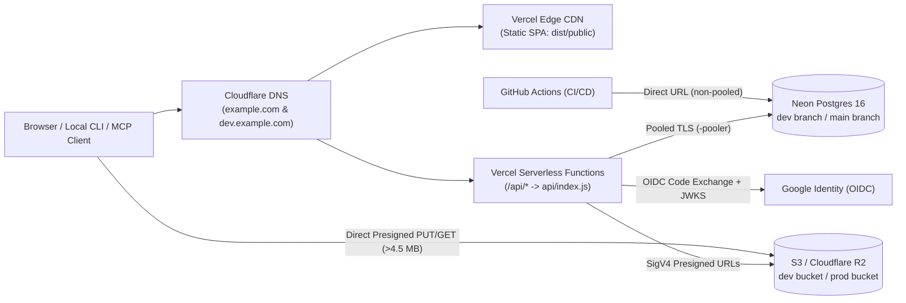

# MyArtifact Cloud Deployment Methodology (Vercel + Neon + Cloudflare R2)

This guide documents the **architecture and deployment methodology** for running MyArtifact Cloud in a stateless serverless topology across two isolated environments (**`dev`** and **`prod`**) using:

- **Edge DNS & TLS:** Cloudflare DNS
- **Frontend CDN & Serverless API:** Vercel (Node.js 22 Runtime)
- **Database:** Managed Serverless PostgreSQL 16 (Neon)
- **Object Storage:** S3-compatible Object Storage (Cloudflare R2) for large binary artifacts & checkpoints (`> 4.5 MB`)
- **Identity:** Google OpenID Connect (OIDC) + PKCE Loopback & Device Authorization Flow for CLI/MCP clients

---

## 1. Reference Topology & Request Flow



### Routing Model
- Static web assets (`dist/public`) are served directly from Vercel's Edge CDN.
- All `/api/*` and `/favicon.svg` requests are rewritten internally to the serverless entrypoint (`api/index.js`), which preserves the original request path via `__ma_path` and delegates to the singleton `CloudHttpRuntime`.
- Deep-link SPA paths (`/artifacts/:slug`, `/s/:token`, `/auth/cli/authorize`, `/auth/device`) fall back to `/index.html`.

---

## 2. Serverless Adaptation Methodology

Adapting a local-first/container application to stateless serverless execution requires five design invariants:

1. **Deterministic Cryptographic Key Derivation (`MYARTIFACT_SECRET`)**
   - Serverless instances have ephemeral `/tmp` storage and spin up concurrently across cold starts. Writing random keypairs to disk invalidates session cookies and JWTs between invocations.
   - Instead, inject one 256-bit master secret (`MYARTIFACT_SECRET`, generated via `openssl rand -hex 32`) per environment. `CloudTokenService` uses HKDF-SHA256 to deterministically derive:
     - The **ES256 (`prime256v1`) JWT signing keypair** for CLI/MCP bearer tokens.
     - The **HMAC-SHA256 cookie secret** for `__Host-ma_session` cookies and CSRF tokens.

2. **Pooled Runtime Connections vs. Direct Migration Connections**
   - **Runtime (`DATABASE_URL`):** Must use the **pooled (`-pooler`)** connection string with a low per-isolate pool ceiling (`PG_POOL_MAX=3`), avoiding connection exhaustion across parallel function invocations.
   - **CI/CD Migrations (`DIRECT_DATABASE_URL`):** Schema DDL (`src/cloud/migrations/001_cloud_schema.sql`) and advisory locks should run against the **direct (non-pooled)** endpoint from CI before or during rollout.
   - **Shell Safety:** Neon connection strings commonly include multiple query parameters (`?sslmode=require&channel_binding=require`). Always quote or parse URLs in scripts rather than sourcing unquoted lines in `bash` (where `&` acts as a command separator).

3. **Realtime Sync Without Persistent WebSockets**
   - Standard serverless functions cannot hold long-lived `/ws` upgrade sockets or dedicated PostgreSQL `LISTEN/NOTIFY` connections (`enableListenNotify: false` in serverless mode).
   - The web client gracefully falls back from WebSocket push to lightweight, visibility-aware conditional polling (`/api/sync` with `ETag` / `304 Not Modified`).

4. **Bypassing the 4.5 MB Serverless Payload Limit**
   - Vercel Functions enforce a `4.5 MB` HTTP request/response payload cap.
   - Standard source artifacts (`react`, `html`, `markdown`, `svg`, `mermaid`) and small metadata stay well under `4.5 MB` and are stored via `PostgresBlobStore` (`cloud_blobs`) or S3.
   - Large binary payloads (e.g., TensorBoard `.tfevents` or model checkpoints) require **S3/R2 configuration** so `S3CompatibleBlobStore` issues short-lived **SigV4 presigned `PUT`/`GET` URLs** directly between the client (Browser/CLI) and object storage, bypassing the serverless function body limit.

5. **Strict Function-to-Database Co-Location**
   - Pin Vercel Functions (`"regions": ["<vercel-region>"]` in `vercel.json`) to the exact same geographic region as the Neon Postgres project (`<neon-region>`). Every authenticated API request executes RBAC + session checks against Postgres; cross-region hops add avoidable latency on every call.

---

## 3. Two-Environment Isolation (`dev` vs `prod`)

Never share stateful resources, secrets, or OAuth clients across environments:

| Concern | `dev` Environment | `prod` Environment |
| :--- | :--- | :--- |
| **Git Branch** | `dev` (or feature/preview branches) | `main` |
| **Vercel Target** | Preview Environment | Production Environment |
| **Canonical Domain** | `https://dev.example.com` | `https://example.com` (`www` -> `308` redirect) |
| **PostgreSQL** | Isolated Neon `dev` branch (scale-to-zero) | Neon `main` branch (PITR enabled) |
| **Object Storage** | Dedicated bucket (`<app>-dev`) + local/dev CORS | Dedicated bucket (`<app>-prod`) + strict prod CORS |
| **Google OAuth** | Separate OAuth 2.0 Web Client (`Dev`) | Separate OAuth 2.0 Web Client (`Prod`) |
| **Signing Secret** | Independent `MYARTIFACT_SECRET` | Independent `MYARTIFACT_SECRET` |

---

## 4. Step-by-Step Provisioning Methodology

### 4.1 Database Branching & Schema Migration
1. Create one Neon PostgreSQL 16 project in `<neon-region>`, keeping `main` for production.
2. Create a child branch named `dev` from `main`.
3. Extract **both** `--pooled` and direct connection strings per branch (`--ssl require`).
4. Execute `src/cloud/migrations/001_cloud_schema.sql` idempotently (`CREATE TABLE IF NOT EXISTS` / `CREATE INDEX IF NOT EXISTS`) via `psql -v ON_ERROR_STOP=1` against each branch's direct URL and verify all expected tables exist in `information_schema.tables`.

### 4.2 Object Storage & Browser CORS Policy
1. Provision separate buckets for `prod` and `dev`.
2. Apply an S3-compatible CORS policy on each bucket so browser clients can perform presigned uploads (`PUT`) and downloads (`GET`) directly against the storage endpoint:
   ```json
   {
     "rules": [
       {
         "allowed": {
           "origins": ["https://example.com"],
           "methods": ["GET", "PUT", "HEAD"],
           "headers": ["Content-Type", "Authorization", "x-amz-date", "x-amz-content-sha256"]
         },
         "exposeHeaders": ["ETag"],
         "maxAgeSeconds": 3600
       }
     ]
   }
   ```
   *(For the `dev` bucket, set `origins` to your dev domain and local development URLs.)*
3. Configure least-privilege **Object Read & Write** S3 API tokens per bucket (`MYARTIFACT_S3_ACCESS_KEY` / `MYARTIFACT_S3_SECRET_KEY`), paired with `MYARTIFACT_S3_ENDPOINT=https://<account-id>.r2.cloudflarestorage.com`, `MYARTIFACT_S3_REGION=auto`, and `MYARTIFACT_S3_FORCE_PATH_STYLE=true`.

### 4.3 Identity Provider (Google OIDC)
1. Create **two separate** OAuth 2.0 Web Application clients in Google Cloud Console (`Dev` and `Prod`) so compromised or misconfigured preview tokens cannot cross boundaries.
2. Register exact Authorized Redirect URIs (Google OAuth does not support wildcard subdomains):
   - `dev`: `https://dev.example.com/api/auth/google/callback`
   - `prod`: `https://example.com/api/auth/google/callback`
3. Pin `MYARTIFACT_PUBLIC_URL` per environment (`https://dev.example.com` and `https://example.com`) so OAuth state and callback URLs stay deterministic regardless of ephemeral preview URLs.

### 4.4 Vercel Project, Variables & `.vercelignore`
1. Ensure `.gitignore` ignores `.vercel` and `.env*` while keeping `!.env.example` tracked (`!.env.example` must appear **after** `.env*`).
2. Use `.vercelignore` to exclude local test fixtures, docs, and archives without excluding `src/` or `api/` (which Vercel needs for `npm run build`).
3. Inject all environment variables scoped cleanly to `preview` (`dev`) and `production` (`prod`) using stdin (`printf '%s'`) to prevent trailing newlines in secrets:
   - Required core: `MYARTIFACT_MODE=cloud`, `MYARTIFACT_PUBLIC_URL`, `DATABASE_URL`, `MYARTIFACT_SECRET`, `GOOGLE_CLIENT_ID`, `GOOGLE_CLIENT_SECRET`
   - Recommended storage/ops: `DIRECT_DATABASE_URL`, `MYARTIFACT_S3_ENDPOINT`, `MYARTIFACT_S3_BUCKET`, `MYARTIFACT_S3_REGION`, `MYARTIFACT_S3_FORCE_PATH_STYLE`, `MYARTIFACT_S3_ACCESS_KEY`, `MYARTIFACT_S3_SECRET_KEY`, `RESEND_API_KEY`

### 4.5 CI/CD Migration Gate
1. Run `npx tsc --noEmit`, `npm run build`, and `npm test` on every pull request and push to `dev` / `main`.
2. On pushes to `dev` or `main`, run `psql "${DIRECT_DB_URL}" -v ON_ERROR_STOP=1 -f src/cloud/migrations/001_cloud_schema.sql` using repository secrets (`DEV_DIRECT_DATABASE_URL` / `PROD_DIRECT_DATABASE_URL`) so schema updates stay backward-compatible and idempotent.

---

## 5. Cloudflare DNS & TLS Cutover Methodology

1. Attach `<domain>`, `www.<domain>` (`308` redirect to apex), and `dev.<domain>` to the Vercel project.
2. Add the DNS records requested by Vercel inside Cloudflare DNS:
   - Apex (`@`): `A` record pointing to Vercel's Anycast IP (`76.76.21.21` or project-specific IP displayed by Vercel).
   - Subdomains (`www`, `dev`): `CNAME` records pointing to Vercel's DNS target (`cname.vercel-dns.com` or project-specific CNAME displayed by Vercel).
   - Domain verification (if requested by Vercel): `TXT` record under `_vercel`.
   - CAA record (recommended): `0 issue "letsencrypt.org"` so Vercel automated certificate issuance is never blocked.
3. **Proxy Status (Critical):**
   - **Recommended:** Keep Vercel records on **DNS Only (Grey Cloud)**. Vercel already provides Anycast CDN, DDoS mitigation, and automated Let's Encrypt TLS.
   - **If Orange Cloud (Cloudflare Proxy) is required:**
     1. Set Cloudflare **SSL/TLS Encryption Mode** to **`Full (Strict)`** (never `Flexible`, which triggers an infinite HTTPS redirect loop).
     2. Add a Cloudflare WAF Custom Skip Rule (or Page Rule) bypassing security challenges/redirects for `/.well-known/acme-challenge/*` so 90-day certificate renewals never fail.

---

## 6. Verification, Rollback & Key Rotation Runbook

### Post-Deploy Smoke Checks
1. **Health & Region:** `curl -i https://<env-domain>/api/health`
   - Expect `HTTP/2 200`, `x-vercel-id` starting with `<vercel-region>::`, and JSON `{"ok":true,"mode":"cloud","googleOidcConfigured":true,...}`.
2. **Auth Providers:** `curl -s https://<env-domain>/api/auth/providers` -> verify `googleEnabled: true` and `allowDeviceFlow: true`.
3. **Browser & CLI Flows:**
   - Sign in via browser (verifies `__Host-ma_session` cookie + CSRF token).
   - Run `myartifact auth login --cloud https://<env-domain>` and `myartifact push` (verifies OAuth loopback/device flow + RBAC).
   - Upload/download a `> 5 MB` artifact/checkpoint when R2 keys are active (verifies SigV4 + bucket CORS).

### Rollback & Secret Rotation
- **Application Rollback:** Promote the previous known-good deployment in Vercel (keep SQL migrations strictly additive/backward-compatible so older builds continue working).
- **Database Recovery:** Use Neon point-in-time recovery (PITR) or branch restore on `main` prior to destructive operations.
- **Key Rotation:** Rotating `MYARTIFACT_SECRET` immediately invalidates all active browser `__Host-ma_session` cookies and CLI access JWTs (users re-authenticate cleanly via Google OIDC). Rotate `GOOGLE_CLIENT_SECRET` or R2 S3 keys with zero code changes by updating the Vercel environment variables and triggering a redeploy.
