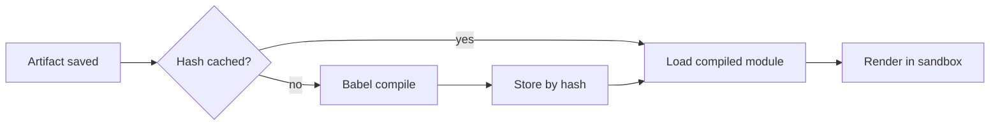

Report · October 2026

# Sandbox latency review

> **Summary.** Median time to first render fell from 1.4s to 0.62s after caching compiled React artifacts. Mermaid renders are now the slowest path.

## Findings

| Artifact type | Before | After | Change |
| :-- | --: | --: | --: |
| React | 1.40s | 0.62s | −56% |
| HTML | 0.31s | 0.29s | −6% |
| Mermaid | 0.88s | 0.84s | −5% |
| Markdown | 0.45s | 0.41s | −9% |

1. Babel compilation was 70% of React render time. A content-hash cache removes it on reload.
2. Mermaid loads its full bundle on every render. Lazy-loading diagram types is the next step.

## How a render flows

## Next steps

- [ ] Lazy-load Mermaid diagram renderers
- [ ] Add render timing to the State tab
- [x] Cache compiled React output by content hash
